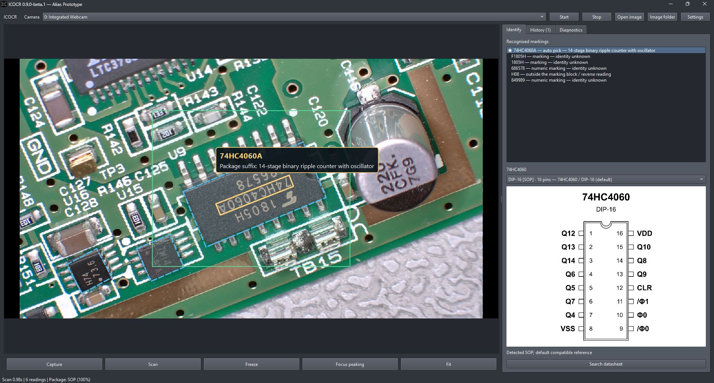
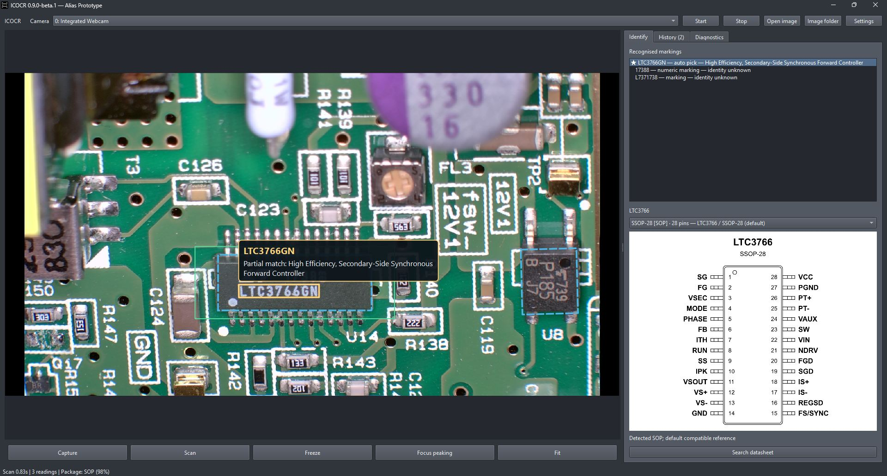
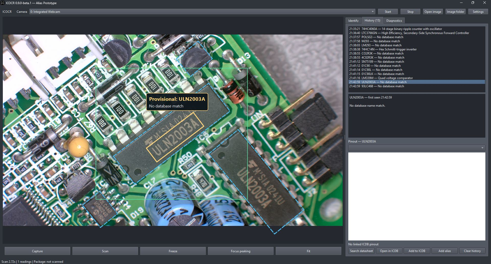

# ICOCR

Read chip markings straight from your microscope camera.

ICOCR is a Windows app for electronics repair and board inspection. It reads the text on a chip, looks it up in the ICDB catalogue, and shows the part description and available pinouts beside the image. Recognition runs locally on your PC.

The current development build is **0.9.0-beta.1**, with a Qt interface for scanning, reviewing readings, and checking pinouts.

## At the bench

1. Choose a camera or capture device, or use **Open image** for a saved photo.
2. Drag a box around a chip and press **Scan** or **Enter**. Clicking a detected chip outline selects and scans that chip.
3. Click a result under **Recognised markings** to see its details and available pinouts. Double-click a reading to make it the selected result and add it to **History**.
4. If there are several package pinouts, choose the one that matches the chip. Use the mouse wheel to zoom the diagram and drag to pan. **Search datasheet** opens a browser search for the part or marking.

**Freeze** holds the current frame for inspection and scanning. **Focus peaking** highlights sharp detail in the preview. **Capture** saves the full-resolution frame, and **Fit** brings the whole image back into view.

**Live recognition** rescans the selected area as you work. It can pause OCR while the scene is unchanged and resume when the image moves. The overlay shows the selected marking and detected chip outline. Recognition settings let you scan one chip or multiple detected chips and try the experimental option to read only inside detected chip bodies.

## How a marking becomes a match

ICOCR ranks the OCR readings, applies recognition rules, and looks for matches in ICDB. The rules can join supported two-line markings. With a configured package classification model, package information can help interpret the reading.

A saved **marking alias** links the text printed on a chip to its catalogue entry. This is useful when the top marking differs from the full part number. If a marking matches several devices, review the candidates before choosing one. The **Diagnostics** tab shows the OCR lines, candidates, and rules used in the last scan.

Before relying on a pinout at the bench, check the marking, physical package, and manufacturer’s datasheet.

## Working with ICDB

ICOCR and [ICDB](https://github.com/SpaceMonkey9000/ICDB) use the same **ICSuite DATA** folder. ICDB is where you edit component records, maintain marking aliases, and publish pinout diagrams.

**History** keeps readings for the current session. From a selected reading, you can use **Open in ICDB** to open the matched device, **Add to ICDB** to start a new component record, or **Add alias** to attach the observed marking to an existing device. In this beta, those actions require the matching ICDB source build with its Qt environment set up.

After saving changes in ICDB, use **Settings → Tools → Reload database** in ICOCR to pick up the updated catalogue and pinout references.

## Examples

Reading a microcontroller marking and displaying a database reference.

Reading an LM2901M marking and showing the LM2901 pinout.

## Getting started

1. Download a Windows installer or portable build. Use the CPU build for OCR without an NVIDIA GPU, or the GPU build for CUDA acceleration on compatible NVIDIA hardware. [ICOCR releases](https://github.com/SpaceMonkey9000/ICOCR/releases)
2. Install or extract ICOCR, and install the separate **ICSuite DATA** package for the component database and reference files. Both packaged app builds include their Python runtime.
3. Start ICOCR and check the DATA location in **Settings → Data and documentation**, especially if you already use ICDB.

The catalogue and pinout library are still growing. Faint or damaged markings, very small packages, and short codes can still need a manual lookup.

For more detail, see the [installation notes](ICOCR/README.md), [user guide](ICOCR/docs/USER_GUIDE.md), [troubleshooting guide](ICOCR/docs/TROUBLESHOOTING.md), and [changelog](ICOCR/CHANGELOG.md).

## Reporting a missed reading

Include a clear chip image, the expected marking, what ICOCR read, and the application version. Add the last scan’s diagnostic output when available. [Open an issue](https://github.com/SpaceMonkey9000/ICOCR/issues)
