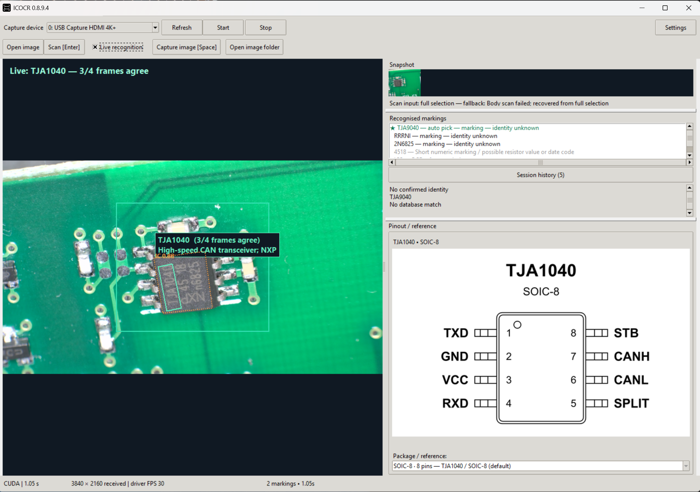
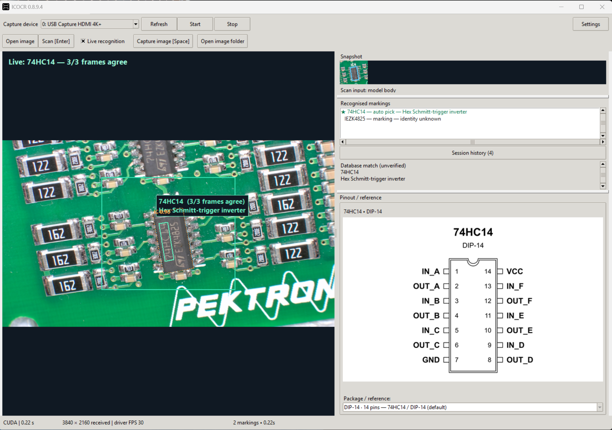
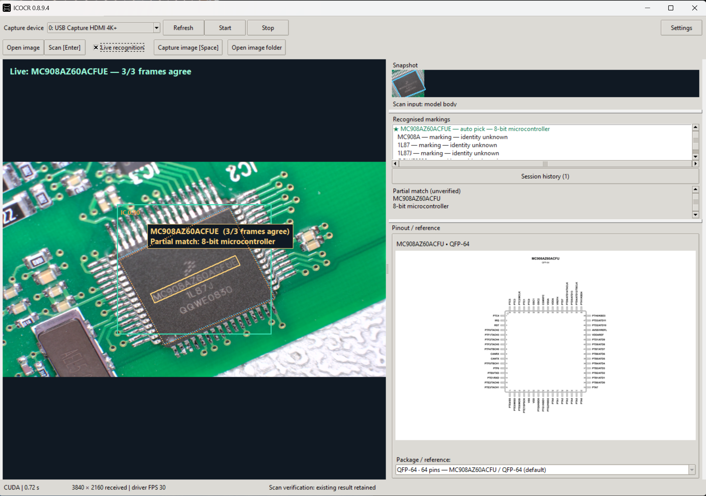

# ICOCR

Read chip markings straight from your microscope camera.

ICOCR is a Windows app for electronics repair and board inspection. It reads the text on a chip, checks it against a component database, and shows the available description and pinout alongside the image.

It puts the marking and reference information in one place, so there’s less typing and less switching between windows while working on a board.

## At the bench

Connect a microscope camera or open a saved photo, select the chip, and scan. Live recognition can keep reading as you move between components.

- **Read from a camera or a photo.** Use a live microscope feed, a supported capture device, or an image you already have.
- **See the result on the image.** The recognised marking appears over the chip.
- **Look up the part.** Matching database entries can show what the component does and its available pinout references.
- **Keep track of readings.** Session history lets you revisit chips you’ve already scanned.
- **Read split markings.** Supported markings spread across two lines can be combined for lookup.
- **Work locally.** Image recognition runs on your PC; camera frames and photos aren’t sent to a cloud OCR service.

## A few examples

Reading a microcontroller marking and displaying a database reference:

Reading an LM2901M marking and showing an LM2901 reference:

## Getting started

Download the application and the separate **ICSuite DATA** package from the [Releases page](https://github.com/SpaceMonkey9000/ICOCR/releases). DATA contains the component database, recognition models, and reference files.

1. Install ICOCR and ICSuite DATA. Python isn’t needed for the installed version.
2. Open ICOCR and start your camera, or choose **Open image**.
3. Drag a selection around a chip and press **Enter** to scan.
4. Enable **Live recognition** for ongoing camera readings.

CPU and GPU builds are available. The CPU version works without an NVIDIA GPU; the GPU build supports acceleration on compatible NVIDIA hardware.

ICOCR is part of ICSuite. **ICDB** is the companion app for editing the component database and managing pinout references.

## Still a work in progress

ICOCR is being developed and tested on real boards. Clear focus and even lighting make a big difference, and some faint, damaged, or shortened markings will still need a manual lookup.

A successful text reading isn’t the same as a confirmed part identification. Check the marking, package, and datasheet before relying on a suggested match or pinout.

For setup details, see the [installation notes](ICOCR/README.md), [user guide](ICOCR/docs/USER_GUIDE.md), and [troubleshooting guide](ICOCR/docs/TROUBLESHOOTING.md).

## Reporting a missed reading

An [issue](https://github.com/SpaceMonkey9000/ICOCR/issues) with a clear chip image, the expected marking, and what ICOCR actually read gives me something useful to test against. Include the application version and diagnostic output when available.
